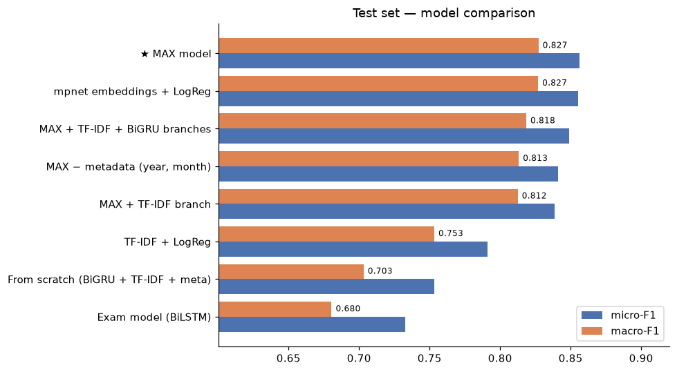
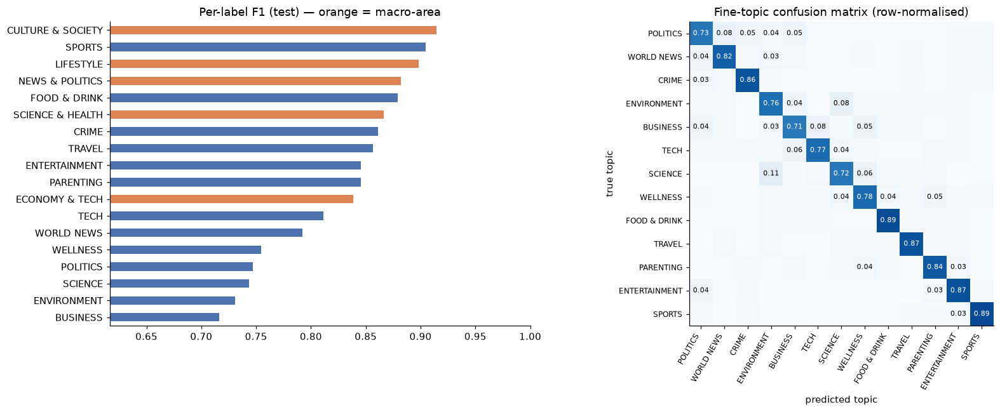

# Multi-label News Topic Classification

A multimodal deep-learning pipeline that assigns news articles to **all** the topics they belong to. Each article
gets 2–3 of 18 labels (13 fine-grained topics and 5 macro-areas). The model reads the headline, the short
description and the publication date.

**Final model (test set):** macro-F1 **0.827**, micro-F1 **0.856**, PR-AUC **0.894**. Across 5 seeds the standard
deviation is ≤ 0.001.

The written exam design scored 0.680 macro-F1 on the same test set, so the final model is **14.7 points** better.



## Background

This started as my written exam solution for *Machine Learning, Artificial Neural Networks and Deep Learning*
(University of Milan, June 2026). The exam design was an Embedding + BiLSTM branch on the text, an MLP on the
Bag-of-Words counts, and scaled date features, with a sigmoid output trained with binary cross-entropy. That design
had to use only the course techniques. This repository drops that constraint and asks how far the same problem can
be pushed with sound ML engineering.

## Results

| Model | micro-F1 | macro-F1 | PR-AUC |
|---|---|---|---|
| Exam model (Embedding + BiLSTM + BoW MLP) | 0.733 | 0.680 | 0.731 |
| Improved from scratch (BiGRU + max/mean pooling + TF-IDF + date embeddings) | 0.753 | 0.703 | 0.765 |
| TF-IDF + Logistic Regression (baseline) | 0.791 | 0.753 | 0.790 |
| Pretrained embeddings + Logistic Regression | 0.855 | 0.827 | 0.865 |
| **MAX: frozen `all-mpnet-base-v2` + date embeddings + MLP head** | **0.856** | **0.827** | **0.894** |
| MAX without metadata | 0.841 | 0.813 | 0.879 |
| MAX + TF-IDF branch | 0.838 | 0.812 | 0.877 |
| MAX + TF-IDF + BiGRU branches | 0.849 | 0.818 | 0.873 |

Each model's decision rule is selected on the validation set, and every score above is on the held-out test set,
which is used only once.

**What we learned:**
1. **Transfer learning is the decisive step.** With about 18k training texts, a network trained from scratch
   cannot beat a linear TF-IDF model. A frozen pretrained sentence encoder beats it by 7.4 points.
2. **The publication date matters.** HuffPost's editorial mix changes a lot over time, and removing year and month
   costs 1.4 points.
3. **More capacity is not better.** Adding the TF-IDF or BiGRU branches on top of the pretrained embedding makes the
   model overfit. The simplest head on the best representation wins.
4. **The decision rule is a product choice.** Per-label thresholds tuned on validation improve macro-F1. Decoding
   that respects the topic taxonomy raises exact-match accuracy from 0.73 to 0.81 at the same F1.



## What the notebook covers

1. **Data:** builds the dataset from public HuffPost data, then runs an exploratory analysis of label frequencies,
   text lengths and topic drift over the years.
2. **Leak-free protocol:** a stratified 70/15/15 split. Every fitted transformation (vocabularies, IDF weights, year
   lookup) is fitted on the training set only.
3. **Evaluation toolkit:** micro-, macro- and sample-F1, Hamming loss, exact match and PR-AUC, compared under four
   decision rules: 0.5, per-label thresholds, top-2 guarantee, and taxonomy-consistent decoding.
4. **Models:**
   - a linear baseline;
   - a faithful reproduction of the exam model;
   - an improved model trained from scratch;
   - linear and neural heads on a pretrained sentence encoder.
5. **Ablation study and error analysis:** per-label F1, the topic confusion matrix, per-label 2×2 matrices, and the
   most confident mistakes.
6. **Robustness:** the final model is retrained with 5 random seeds to measure the spread.
7. **Packaging:** the trained head is exported to `models/` together with its thresholds and label config, plus a
   `tag(texts, year, month)` inference function.

## Data

The original exam dataset is not public, so the notebook rebuilds one with the same structure from the
[HuffPost News Category Dataset](https://www.kaggle.com/datasets/rmisra/news-category-dataset) (R. Misra, 2022,
CC BY 4.0). That dataset has about 210k articles from 2012–2022; the notebook downloads it automatically from a
[Hugging Face mirror](https://huggingface.co/datasets/heegyu/news-category-dataset). The steps:

1. Merge sections that HuffPost renamed over time (e.g. `GREEN` → `ENVIRONMENT`). Otherwise the model would learn
   when a section was renamed rather than what the article is about.
2. Sample 2,000 articles for each of the 13 topics, 26,000 in total.
3. Map each topic to one or two of 5 macro-areas, which gives 2–3 labels per article, as in the exam.

Limitation: the macro-areas are derived from the topic taxonomy, so they are easier to predict than independently
annotated labels would be.

## Run it

```bash
pip install -r requirements.txt
jupyter notebook MAX.ipynb
```

The run takes about 15–25 minutes on a laptop. Most of that is the one-off text encoding, which takes about
1 minute on a GPU (e.g. Google Colab) and is cached in `data/`.

Using the exported model:

```python
tag(["Apple unveils new chip that promises faster AI on laptops"], year=2021, month=6)
# -> [['TECH', 'ECONOMY & TECH', 'SCIENCE & HEALTH']]
```

## Tech stack

TensorFlow / Keras 3 (functional multi-input model with preprocessing layers inside the graph), sentence-transformers,
scikit-learn, pandas, matplotlib.

## Next steps

- Fine-tune the encoder end-to-end on a GPU.
- Train on the full corpus of about 200k articles.
- Use a time-based split to measure drift.
- Calibrate the probabilities.
- Serve `tag()` behind a small REST API.

---
Myrteza Enkida
